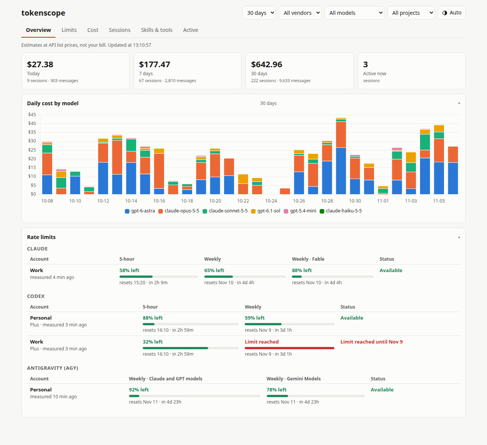
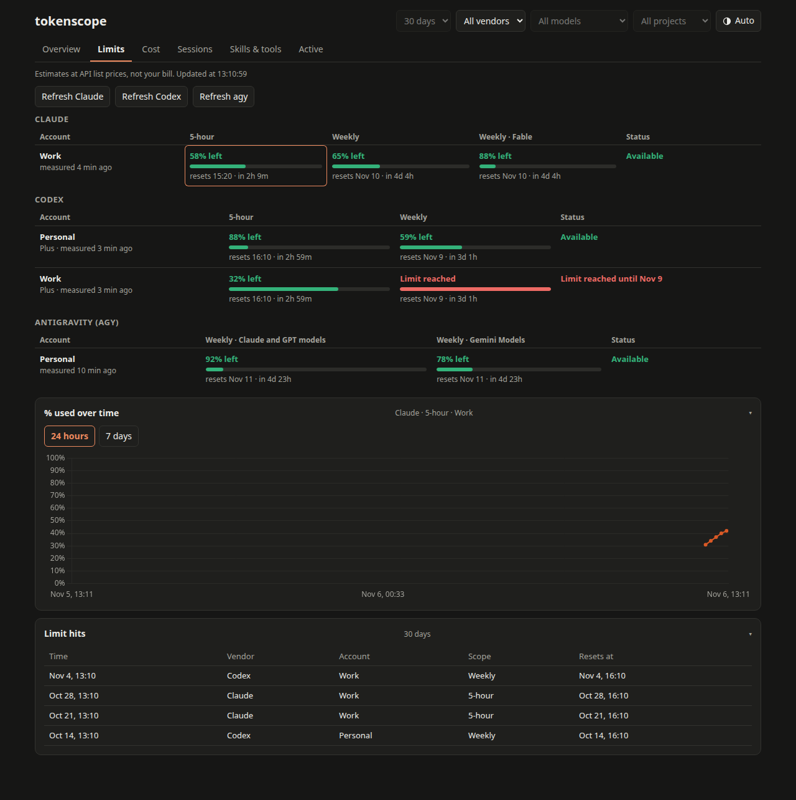
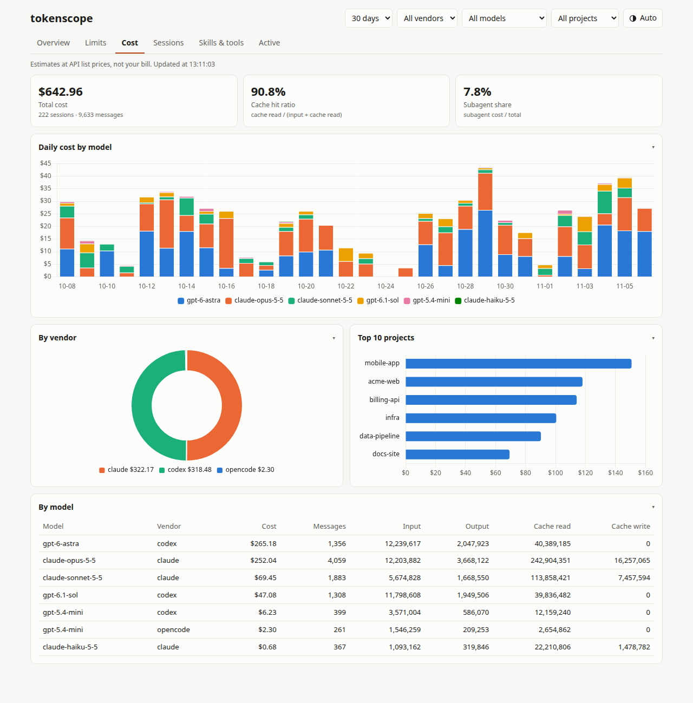

# tokenscope

**See what your AI coding agents cost and how close you are to their rate limits, in one local dashboard.**

tokenscope reads the session logs that Claude Code, OpenAI Codex CLI, OpenCode, Pi and Antigravity (`agy`) already write to your disk. It turns them into token counts, estimated cost per session, project and model, and rate-limit usage over time. Everything runs on your machine. Nothing is uploaded, and no API keys are needed.



## Screenshots

These use made-up demo data (`scripts/demo/`); nothing in them is a real project or account.

| Rate limits, one row per account (dark theme) | Cost by day, vendor, project and model |
|---|---|
|  |  |

## Why

If you use several coding agents on subscriptions, it's hard to answer simple questions:

- How much would today's work have cost at API prices? Which project or model is eating the budget?
- How close am I to the 5-hour or weekly limit, and when will I hit it at the current pace?
- Which sessions are running right now, and which skills or tools do the agents use most?

Each vendor shows part of this in a different place, or not at all. tokenscope puts it all in one place.

## Features

- **Five agents, one view.** Supports Claude Code, Codex CLI, OpenCode, Pi and Antigravity. Multiple accounts per vendor are kept apart.
- **Estimated cost.** Prices come from a built-in table of API list prices (`assets/pricing.toml`) and are computed at query time, so a price update applies to history too. When a model has no known price, totals say `≥ $X` or `n/a` instead of showing a silent `$0`.
- **Rate limits.** Shows 5-hour and weekly usage %, reset times and a projected time-to-limit. Old readings are marked stale instead of being shown as current.
- **Web dashboard** with six tabs: Overview, Limits, Cost, Sessions, Skills & tools, Active. It has a light/dark theme switch (Auto follows your system) that is remembered per browser.
- **Terminal UI** for a quick look without a browser.
- **Claude Code status line** that adds a line like `5h 44% · week 54% · $12.00 today` under your existing status line.
- **Privacy.** Account IDs are stored only as short hashes. Credential files are never opened. The web server binds to `127.0.0.1` only and rejects foreign `Host` headers.
- **Single binary.** Data lives in SQLite (bundled) and the web assets are embedded. There is no runtime to install.

## Supported platforms

**Linux only.** macOS and Windows are not supported and not planned. Log paths, the status line wrapper (`sh`) and the agent CLIs are assumed to follow Linux conventions.

| | Supported | Tested on |
|---|---|---|
| OS | Linux (any distro) | Ubuntu 24.04 LTS (kernel 7.0, glibc 2.39). CI also runs on GitHub's `ubuntu-latest`. |
| Architecture | x86_64, aarch64 | aarch64 binaries are built and unit-tested in CI but not run on real hardware. |
| Prebuilt binaries | x86_64 and aarch64, statically linked (musl) | x86_64 |
| Rust (source builds only) | 1.85+ (edition 2024) | 1.99.1 |
| Browser (web dashboard) | any current browser | Chrome 154, Firefox 159 |
| Terminal (TUI) | any terminal with 256 colors | bash on GNOME Terminal |

Supported agents and the versions whose log formats were verified:

| Agent | Verified version | Reads from |
|---|---|---|
| Claude Code | 2.1.318 | `~/.claude/projects/` and status line snapshots |
| OpenAI Codex CLI | 0.165.0 | `~/.codex/sessions/` |
| OpenCode | DB schema as of Nov 2026 | `~/.local/share/opencode/opencode.db` |
| Pi (`pi`) | 1.5.0 (session format v3, from its source; no real sessions verified yet) | `~/.pi/agent/sessions/` |
| Antigravity (`agy`) | 1.5.1 | `agy -p "/usage"` |

The agents' log formats are undocumented and can change in any release. If a newer agent version stops showing up, run `tokenscope doctor` and open an issue with the agent's version.

## Install

One line, no Rust needed. The installer downloads a static binary (works on any distro) from GitHub Releases, checks its sha256, and puts it in `~/.local/bin`:

```sh
curl -fsSL https://raw.githubusercontent.com/Cuong102904/tokenscope/main/install.sh | sh
```

- Pin a version: `curl -fsSL …/install.sh | VERSION=v0.1.0 sh`
- Install elsewhere: `… | INSTALL_DIR=/usr/local/bin sh` (needs write access there)
- Update: run the same command again.
- Uninstall: `rm ~/.local/bin/tokenscope` (and `rm -r ~/.tokenscope` to drop the data).

If you prefer to read the script before running it, it's [`install.sh`](install.sh).

**Build from source** (Rust 1.85+; SQLite is bundled, so there are no other system dependencies):

```sh
cargo install --git https://github.com/Cuong102904/tokenscope
```

**Upgrading from `agent-usage`** (the pre-0.1 name): the first run of `tokenscope` moves `~/.agent-usage` to `~/.tokenscope` and renames the database, keeping all history. If you had pasted the old status line snippet, run `tokenscope statusline --print-snippet` and paste the new one.

## Quick start

```sh
tokenscope doctor    # which agents were found on this machine
tokenscope collect   # import their logs into the local database
tokenscope serve     # open http://127.0.0.1:8765
```

`serve` collects again in the background every 30 seconds, so the dashboard stays current while you work.

## Commands

| Command | What it does |
|---|---|
| `tokenscope doctor` | Lists each data source with its status, record counts, last limit reading and last error. |
| `tokenscope collect` | Scans all agent logs once. Re-runs are incremental. |
| `tokenscope collect --watch [--interval N]` | Keeps collecting every N seconds. Use this if you only use the TUI or status line. |
| `tokenscope serve [--port 8765]` | Starts the web dashboard on `127.0.0.1`. |
| `tokenscope tui` | Starts the terminal dashboard. `r` refreshes, `q` quits. |
| `tokenscope status [--json] [--refresh]` | Prints a one-shot summary. `--refresh` also asks `claude`, `codex` and `agy` for their current limits (each at most once every 5 minutes). |
| `tokenscope statusline …` | Wraps the Claude Code status line (see below). |

## Where the data comes from

| Agent | Source | Notes |
|---|---|---|
| Claude Code | `~/.claude/projects/**/*.jsonl` | Tokens and cost per message. |
| Claude Code open sessions | `~/.claude/sessions/<pid>.json` | Which `claude` sessions are open and whether each is working or waiting for input. Only those `.json` files are read (never the `.key` files next to them), and only while their process is running. |
| Claude Code limits | `claude -p --no-session-persistence "/usage"`, and optionally status line snapshots | `/usage` runs on demand only (Refresh Claude button or `status --refresh`, at most once every 5 minutes) and saves no session. The status line hook below adds a reading on every message. |
| Codex CLI | `~/.codex/sessions/**/*.jsonl` | Tokens plus the rate-limit info Codex logs. |
| Codex limits | `codex app-server` (`account/rateLimits/read`) | On demand (Refresh Codex button or `status --refresh`, at most once every 5 minutes), and right after an account switch (see below). Structured JSON, no model call; only the signed-in account. |
| OpenCode | `~/.local/share/opencode/opencode.db` | Opened read-only. |
| Pi | `~/.pi/agent/sessions/**/*.jsonl` (or `$PI_CODING_AGENT_SESSION_DIR`, `$PI_CODING_AGENT_DIR/sessions`) | Tokens, model and tool calls per reply, plus side calls such as cache warming. Pi keeps no account id, so it has no rate-limit cards. `auth.json` is never read. |
| Antigravity | `agy -p "/usage"` | Run on demand only, at most once every 5 minutes. |

Log files are only read, never modified.

The Active tab shows sessions that are open now and those written in the last few minutes, as "N open · M working". Claude Code sessions are seen directly, so an open session waiting for input shows as idle. For Codex, OpenCode and Pi only the logs are visible: a session counts as working while its log was written in the last `active_minutes`.

Limits are shown one row per account, with a status column ("Available", "Limit reached until …", "No current reading"). When a Claude or Codex window resets or its reading goes stale, the dashboard keeps the old number (muted) and asks the tool for a new reading on its own; agy is refreshed only by its button, because its `/usage` may use quota. Windows last seen under an older plan (a monthly window from before a free → Plus upgrade) are dropped.

**Several Codex accounts.** Codex can only report the account that is logged in. If you switch accounts with another tool (for example [codex-multi-auth](https://www.npmjs.com/package/codex-multi-auth)) or with `codex login`, tokenscope notices within one collect interval and asks for the new account's limits right away. It does this by watching the modification time, size and inode of `~/.codex/auth.json`; the file itself is never opened. Each account you switch to gets its own row, showing the numbers from the last time it was logged in. tokenscope does not switch accounts itself.

## Claude Code rate limits

Claude Code keeps its 5-hour and weekly usage on Anthropic's side; no local log has it. tokenscope reads it in two ways, and neither touches your Claude credentials:

- **On demand:** the **Refresh Claude** button on the Limits tab (or `tokenscope status --refresh`) runs `claude -p --no-session-persistence "/usage"` and reads the 5-hour, weekly and per-model weekly numbers it prints. It runs at most once every 5 minutes, takes a few seconds and doesn't count as a Claude session.
- **Continuously (optional):** Claude Code also passes the same numbers to the status line command on every message. With the status line hook you get a reading per message, which is enough for the projected time-to-limit.

The `/usage` output is text meant for people. If a Claude Code update changes its wording, the refresh reports an error instead of showing wrong numbers.

To add the status line hook:

1. Print the snippet:

   ```sh
   tokenscope statusline --print-snippet
   ```

2. Paste the `statusLine` block it prints into `~/.claude/settings.json` yourself. tokenscope never edits that file.

Your current status line keeps working. Pass it via `--wrap "<command>"` or `--wrap-file <script>` and its output is printed first. `--show` adds the limits and today's cost on a line below it. If anything goes wrong, the wrapper still prints your original status line and exits 0.

## Configuration

Optional. Create `~/.tokenscope/config.toml`:

```toml
claude_account = "work"   # name for the Claude account behind this status line
active_minutes = 5        # without a visible process, a session counts as working if written within N minutes
refresh_seconds = 30      # background collect interval for serve / collect --watch

[labels]                  # friendly names for hashed account IDs (shown on the Limits and Sessions views)
"codex:f8ce04de" = "Codex (personal)"
```

To override prices, copy `assets/pricing.toml` to `~/.tokenscope/pricing.toml` and edit it. Prices are $ per 1M tokens, and the longest model-name prefix wins.

## Files

Everything lives in `~/.tokenscope/`:

- `tokenscope.db`: the SQLite database. Delete it to rebuild from logs.
- `config.toml`, `pricing.toml`: optional overrides.
- `snapshots/`: Claude status line limit readings.
- `today.txt`: today's cost, cached for the status line.

## Caveats

- Costs are **estimates at API list prices**, not your bill. Subscription plans are billed differently.
- Rate-limit projections are linear extrapolations of recent usage.

## Development

```sh
cargo fmt --all --check
cargo clippy --all-targets -- -D warnings
cargo test --all-targets
```

CI runs the same three checks (plus `shellcheck install.sh`) on every pull request. `main` is protected: changes land through pull requests with a green CI.

To refresh the README screenshots after a UI change, run `scripts/demo/screenshots.sh`. It seeds made-up data into a throwaway HOME, serves it without your `claude`/`codex`/`agy` on PATH and captures `docs/screenshots/*.png` with headless Chrome (needs python3, node 22+ and google-chrome).

To release: bump `version` in `Cargo.toml`, merge, then push a matching tag (`git tag v0.2.0 && git push customer v0.2.0`). The release workflow tests, builds the static x86_64 and aarch64 binaries and publishes them with checksums to GitHub Releases, where `install.sh` picks them up.

Design notes live in `docs/superpowers/specs/` and the implementation plan in `docs/superpowers/plans/`.
